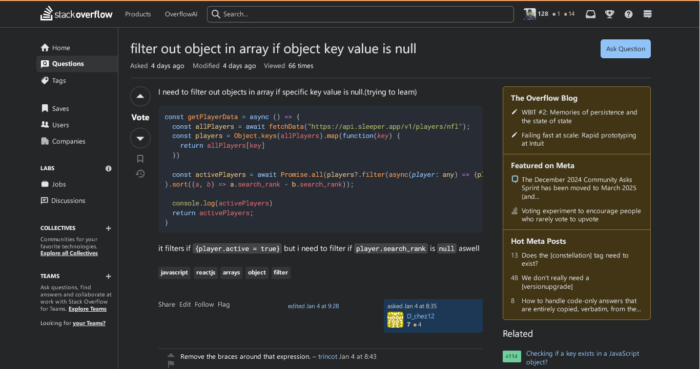
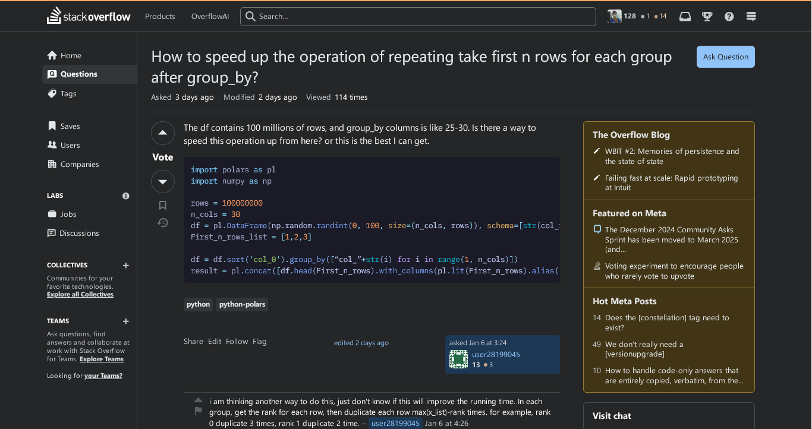
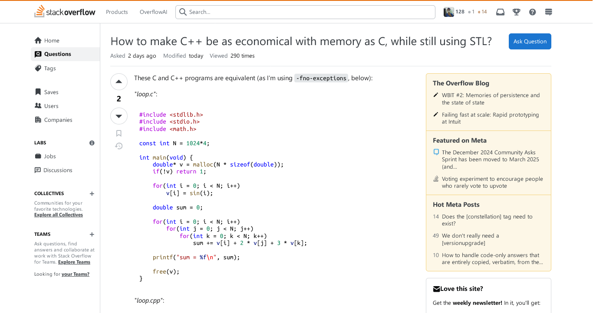
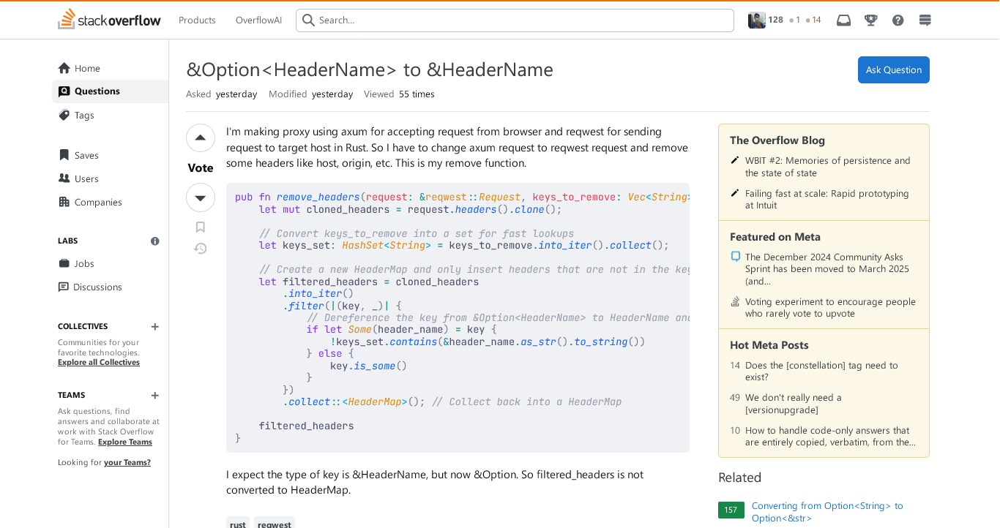

# StackOverflow Syntax Highlight

Allows you to customize how StackOverflow's codeblocks look.

  

  <a href="https://addons.mozilla.org/en-US/firefox/addon/stackoverflow-syntax-highlight/">
    <picture>
      <source srcset="https://i.imgur.com/ZluoP7T.png" media="(prefers-color-scheme: dark)">
    </picture>
  </a>

## Screenshots

